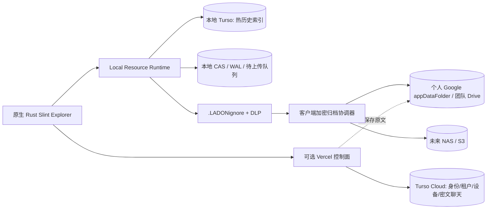

# 27. 基本設計 — Local First / Drive-First / Minimal Vercel

## 1. 架构分区

## 2. 模式

| 模式 | 存储 | 是否需要 Vercel | 权限语义 |
|---|---|---|---|
| 个人完全离线 | 本地 Turso + CAS | 否 | 本机 OS 用户与 LADON Ignore |
| 个人 Drive 归档 | 用户 Drive appDataFolder 或用户普通目录 | 否 | 本机 OAuth 与云盘 ACL；appDataFolder 不可共享 |
| 团队协作 | 普通 Drive 文件夹或 Shared Drive + 本地缓存 | 是（或等价可信控制面） | 成员服务端验证 + 云盘 ACL + 加密密钥 |
| NAS（后续） | SMB/WebDAV/S3 adapter | 团队需要 | 与云盘协议同样的双重授权 |

Drive 配额与文件数量不保证无限历史；历史采用压缩段、checkpoint、索引页减少 API 调用。**不把 Google Drive 当成 SQL 数据库**：上传、列表、更新与权限不具备跨对象数据库事务。

## 3. 数据边界

- 本地 Turso：FileRef、索引、历史热游标、工作空间策略、任务图；含隐私的数据不直接推送共享 Turso Cloud。
- Drive：AES-256-GCM 加密的不可变内容块、事件段、索引页、checkpoint、密文聊天归档；Drive ID 与不透明属性构成 locator。
- Vercel + 远程 Turso：身份 ID、租户/成员/角色、设备授权、目录绑定、短期聊天密文投递队列；不传明文历史和文件名。
- 用户 OAuth Access/Refresh Token：仅安全保存在本机系统凭据存储；不得写 `.json`/Git/日志。原型环境变量接口为开发测试用途。

## 4. 容灾

先 fsync 本地待上传对象 → 加密 → 远端创建不可变对象 → readback 解密并校验 → 保存已验证 locator → 发布索引页 → 根据副本策略回收缓存。云端无可读性保证时本地缓存不可驱逐。断网与配额不足均不得静默丢弃。

## 5. 未实现界限

真实 Google PKCE 客户端、Shared Drive ACL 自动配置、生产多租户注册、密钥分发、Turso sync 与跨设备全量重建仍未端到端实现；这里只提供接口骨架及详细算法。
