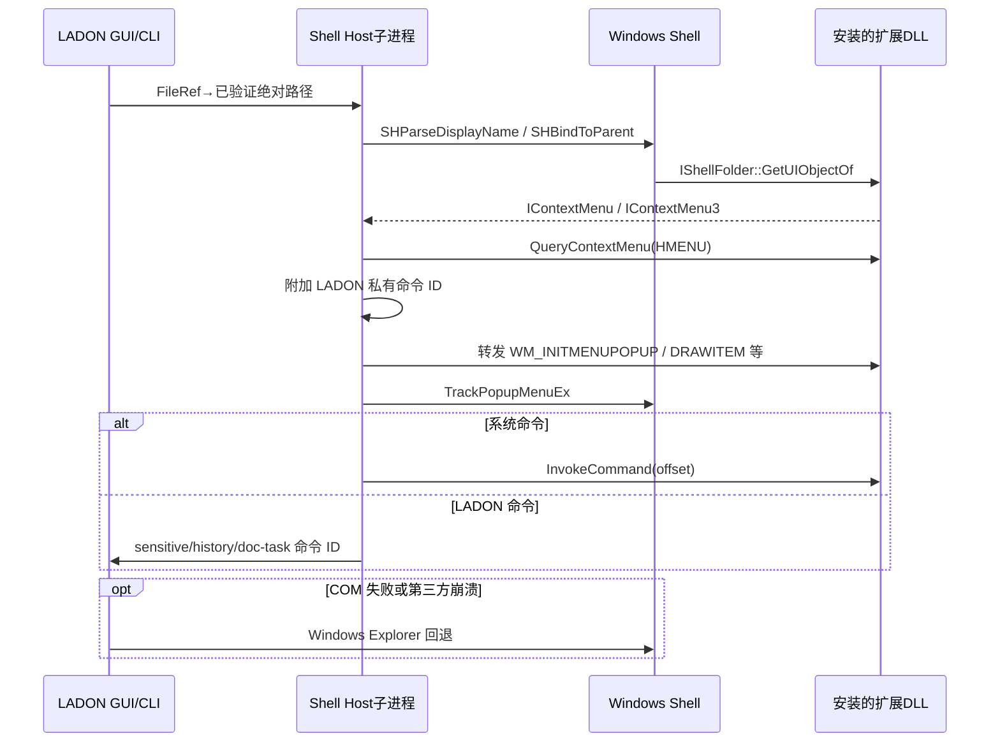

# 40. Windows Shell 右键兼容详细设计（内部設計）

## 1. 需求与兼容范围
REQ-051/052/053/054/065/071。目标为 **用户设备上 Explorer 右键可用操作的等效调用**，非手绘功能表。第三方 Git/7-Zip/TortoiseGit 仅在正确注册、架构匹配且扩展允许第三方宿主时出现。Windows 11 现代 IExplorerCommand 不是所有命令都支持第三方进程重宿主，**提供 Windows Explorer 回退**。

## 2. 技术堆栈
| 层 | 实现 | 状态 |
|---|---|---|
| Rust CLI / Slint UI | 请求右键资源；UI 线程发起异步 shell-host 任务 | CLI 命令已接线；Slint UI 尚未接线 |
| Rust Shell Host | 子进程 `ladon shell-host-internal` | 已提供源码，Windows 未编译验证 |
| Win32 FFI | `native/shell_menu.cpp`, `build.rs` 编译静态桥接库 | 已提供 C++ 源码，未实机验证 |
| 传统 Shell | `SHParseDisplayName→SHBindToParent→IShellFolder::GetUIObjectOf(IID_IContextMenu)` | 单资源支持代码 |
| 扩展菜单 | `QueryContextMenu→TrackPopupMenuEx→InvokeCommand` | 已提供源码 |
| 子菜单/Owner-Draw | `IContextMenu2/3::HandleMenuMsg/HandleMenuMsg2` 消息转发 | 已提供源码 |
| Windows 11 现代菜单 | `IExplorerCommand` 宿主语义 | 设计项，未实现 |
| 不支持项回退 | 系统 Explorer `explorer.exe /select,...` | 已提供 fallback |

## 3. 单文件真实菜单流程

## 4. LADON 命令与安全
- `0x7001` 添加为敏感文件：先验证文件位于当前 Workspace 且没有跟随外部软链接；把 root-anchored 规则原子写入 `.LADONignore`；之后热更新策略。旧云端副本需另行创建清理任务，**不会因为新增规则自动消失**。
- `0x7002` 查看完整历史：映射 FileRef → Turso 时间线，显示事件/版本、云端存储状态和 Diff；CLI Shell host 目前仅返回提示，GUI 未接线。
- `0x7003` 文档即任务：打开选中文档与条款任务，未做 GUI 接线。
- `0x7004` 在 Explorer 中打开：兼容回退。
- Shell 命令不可绕过 LADON 管控：外部程序实际修改文件后由 watcher 捕获，未知来源标记 `external/unknown`。不能拦截扩展对用户磁盘的所有操作，不应声称全面事务化。

## 5. 扩展安全隔离
- **必须使用独立 Shell Host**：经典 Shell 扩展在宿主进程内执行不可信 COM DLL，Rust 的所有权保证对其无效。
- GUI 不 `.wait()` 子进程；通过异步状态回调设置 2 秒弹出反馈、15 秒默认可取消超时（执行中的第三方命令除外，需谨慎终止）；Shell Host 退出后再打开主应用操作菜单。
- 当前 CLI 子进程隔离已接线，但 GUI 生命周期与超时未接线，故整体仍为 `Partial`。
- 在 Shell Host 失败时，直接选择“用 Windows Explorer 打开”，防止功能丢失；对现代扩展不声称完全同屏呈现。

## 6. 兼容矩阵（必须在 Windows 11 实机记录结果）
| 案例 | Classic IContextMenu | Modern IExplorerCommand | 回退 |
|---|---|---|---|
| 普通文件 / 文件夹 | 实机待验收 | 设计 | Explorer |
| Git 仓库内文件 TortoiseGit | 实机待验收 | 设计 | Explorer |
| Git for Windows 命令（依注册） | 实机待验收 | 设计 | Explorer |
| 7-Zip / WinRAR | 实机待验收 | 设计 | Explorer |
| 自绘子菜单与级联 | 实机待验收 | 设计 | Explorer |
| 文件多选、空白区 | 设计，当前桥不支持 | 设计 | Explorer |
| SMB/UNC、长路径、离线盘 | 设计，需实机验证 | 设计 | Explorer |
| 权限受限／杀毒软件扩展 | 设计，需实机验证 | 设计 | Explorer |

## 7. Shell 注册与调用注意事项
- 不直接扫描注册表硬编码菜单文本；利用 shell folder 绑定和 COM 原生语义。`QueryContextMenu` 的返回包含命令 ID 偏移；`InvokeCommand` 要传相对 ID，不是 HMENU 绝对 ID。
- `IContextMenu3` 接收 `WM_MENUCHAR` 等；UI 必须能接受焦点/owner-draw。
- 任何补充功能不可覆盖系统已有快捷键/命令语义，LADON 选项分区显示。

## 8. 来源
- https://learn.microsoft.com/en-us/windows/win32/api/shobjidl_core/nn-shobjidl_core-icontextmenu3
- https://learn.microsoft.com/en-us/windows/win32/shell/how-to-implement-the-icontextmenu-interface
- https://learn.microsoft.com/en-us/windows/apps/desktop/modernize/integrate-packaged-app-with-file-explorer
