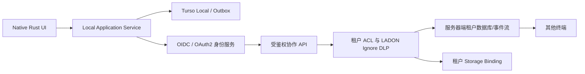

# 41. 账号、租户、团队通信与跨端同步详细设计

## 1. 适用要件
REQ-055/056/057/058/059/066/067/069、NFR-022/023/025/028。

## 2. 分层与边界
身份系统是独立的 **Auth Service**。本地单机模式不强制登录；开启跨终端/成员共享后，登录取得经服务端签名的访问令牌；原生 GUI 仅负责凭据安全存储和视图，不能作为权限最终裁决者。Turso 本地嵌入式数据库保留个人数据，服务器负责共享租户数据的最终授权及冲突协调。**绝不能把 Turso SQLite 文件直接上传到云盘当作多租户数据库。**

## 3. 数据模型（`sql/002_collaboration_shell_agent.sql`）
| 表 | 关键字段 | 功能 |
|---|---|---|
| identities | issuer, external_subject | 外部身份映射 |
| tenants / workspaces | tenant_id, owner_identity_id | 租户与工作空间 |
| memberships | tenant_id, workspace_id, identity_id, role | 角色/隔离 |
| device_sessions | device_public_key, refresh_token_digest, revoked_at | 设备撤销 |
| conversations | tenant_id,workspace_id,kind | AI 或团队会话 |
| chat_messages | sender,client_message_id,body_ciphertext | 加密消息与幂等去重 |
| chat_attachments / chat_task_links | file_ref,version_id / doc_task_id | 文档上下文关联 |
| archive_bindings | provider,external_account_subject,credential_secret_ref | 租户云盘绑定 |
| sync_cursors | device_id,stream,cursor_seq | 增量事件同步 |
| agent_grants | agent_id,scope,allowed_operations,expires_at | 最小权限 |

`chat_messages.body_ciphertext` 禁止明文写入。**DDL 只定义结构，端到端加密/密钥轮转、OAuth 服务端、跨端服务端尚未实现，不得把此数据库表存在视为已完成账号体系。**

## 4. RBAC / ABAC
- 角色：Owner、Admin、Editor、Reviewer、Viewer、Agent。
- 身份来自服务端验证的 OIDC JWT 或设备授权，不得由 CLI 自填 `tenant_id` 或 `role` 获得权限。
- 授权次序：认证→租户→工作空间→资源权限→敏感规则→操作行为→审批→审计。
- `auth.rs` 仅实现纯决策子集和 UT，不提供真实 Token 验签或远端 ACL。
- Agent 的授权由作用域、有效期及操作集合组成；不能因为读权限而取得写/归档权限。
- 分享链接短期有效，服务端签发/撤销，默认不能访问原文件历史的全部版本。

## 5. 聊天与任务
- 会话类型 `ai/team`；不同类型不隐式混流。聊天文件附件存 `FileRef + BaseVersion + PolicyDigest`，显示前再校验访问权限。
- @Agent 触发只读分析任务提案；文件写入仍须批准。团队成员消息不得自动作为 AI 上下文发送。
- 消息事件到要件任务：`chat_messages.id→chat_task_links→doc_tasks→versions/events`，审计可双向追踪。
- 离线聊天 `client_message_id` 为幂等键；上传时服务端以租户+会话进行去重，服务端事件序号并不依赖客户端时钟。

## 6. 跨端一致性与云端
- 每个设备维护加密 outbox，服务端 cursors 分流（files/versions/chat/tasks/membership）；短期断线重连从 ACK cursor 拉取增量。
- 共享元数据经过 ACL 及 Ignore/DLP；敏感路径和文件名也可能泄密；原则上只同步可披露的匿名 ID、摘要和经批准的数据。
- 历史内容位于各工作空间的 Archive Binding，不借用其他租户的云盘授权。
- 旧权限撤销后，刷新 Token 失效、设备退出登录、禁用后续归档和分享；已下载的副本无法自动远程擦除。

## 7. 障害与回滚
令牌失效→本地继续读允许的文件/历史→等待重新授权；同步冲突→保留冲突分支和审计事件；服务端不可用时不得自动让共享操作降级为免鉴权。

## V1.3 租户信任边界

`46_租户与零知识边界.md` 明确服务端真实性校验、双重授权、团队密钥分发未实现项。
